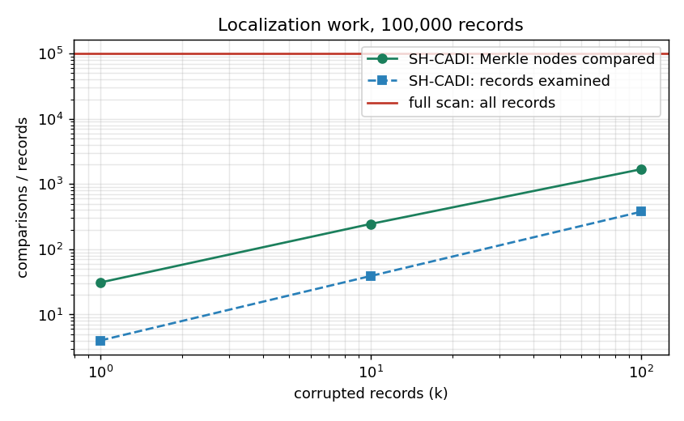
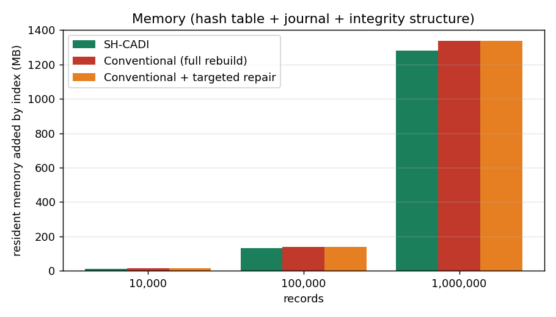
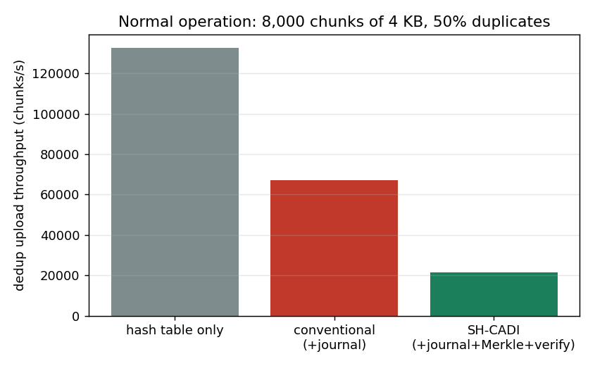
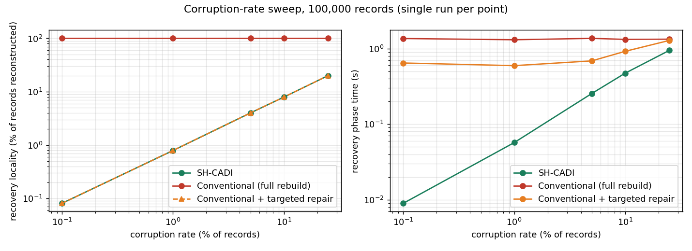
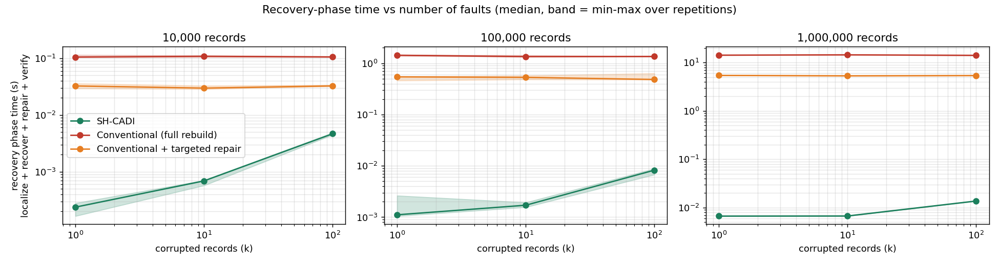
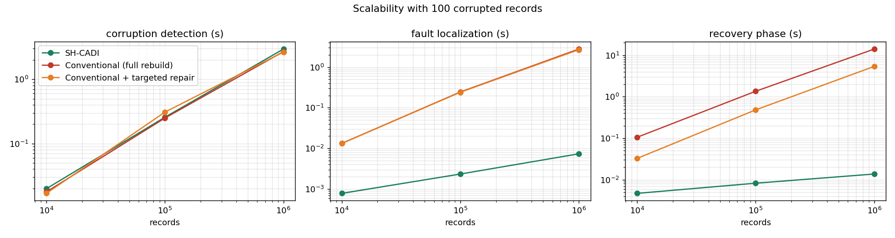

# SH-CADI evaluation results

All numbers below were measured by this code on the machine below and are copied from `results.json`; nothing is estimated.

**Environment:** Python 3.13.14, 20 CPU, 23.78 GB RAM, Windows-11-10.0.26300-SP0. Each (system, size) ran in its own fresh process. Synthetic records (SHA-256 keys, 4 KB nominal chunks), in-memory journal, no disk or network I/O modelled.

**Systems.** *Conventional* = chained hash table + the same sharded journal + Phase-1 sorted-leaf Merkle tree rebuilt on demand; recovery = replay the whole journal and rebuild. *SH-CADI* = same hash table + same journal + incremental bucketed Merkle tree + localized heal. Both get identical recovery information.

## 1. Normal operation (cost of self-healing)

Dedup upload pipeline, 8,000 chunks of 4 KB (50% duplicates), in-memory chunk store, median of 5.

| config | chunks/s | MB/s | time vs hash-table-only | time range (s) |
|---|---:|---:|---:|---|
| hash table only | 132,729 | 543.7 | 1.00x | 0.058-0.070 |
| conventional (+journal) | 67,011 | 274.5 | 1.98x | 0.118-0.121 |
| SH-CADI (+journal +Merkle +verify-before-write) | 21,590 | 88.4 | 6.15x | 0.361-0.394 |

## 2. Per-size basics

| records | system | build (s) | memory added (MB) | journal (MB) | lookup hit (us) | lookup miss (us) | authenticated lookup (us) | insert (us) | clean full verify (s) | peak RSS of whole run (MB) |
|---:|---|---:|---:|---:|---:|---:|---:|---:|---:|---:|
| 10,000 | conventional (full rebuild) | 0.1 | 14 | 2.6 | 0.26 | 0.19 | nan | 7.6 | 0.02 | 54 |
| 10,000 | conventional + targeted repair | 0.1 | 14 | 2.6 | 0.28 | 0.19 | nan | 7.9 | 0.02 | 52 |
| 10,000 | SH-CADI | 0.1 | 13 | 2.6 | 0.29 | 0.19 | 11.2 | 30.0 | 0.02 | 85 |
| 100,000 | conventional (full rebuild) | 1.2 | 140 | 25.9 | 0.47 | 0.28 | nan | 7.8 | 0.27 | 283 |
| 100,000 | conventional + targeted repair | 1.3 | 139 | 25.9 | 0.46 | 0.26 | nan | 7.3 | 0.26 | 259 |
| 100,000 | SH-CADI | 1.2 | 132 | 25.9 | 0.49 | 0.29 | 15.1 | 33.7 | 0.25 | 475 |
| 1,000,000 | conventional (full rebuild) | 12.7 | 1,336 | 260.8 | 0.59 | 0.37 | nan | 8.6 | 2.76 | 2,201 |
| 1,000,000 | conventional + targeted repair | 12.7 | 1,336 | 260.8 | 0.58 | 0.37 | nan | 7.5 | 2.73 | 1,692 |
| 1,000,000 | SH-CADI | 13.9 | 1,281 | 260.8 | 0.98 | 0.53 | 27.8 | 58.0 | 3.44 | 2,203 |

## 3. Fault sweep (k corrupted records, metadata faults of 5 kinds, seeded)

Times in ms, median (min-max) over repetitions. *Recovery phase* = localize + recover + repair + verify; *total* adds detection. Detection reads every record in both systems.

| records | k | system | detect | localize | recovery phase | total | records reconstructed | spurious removed | recovery locality | success | localized exactly |
|---:|---:|---|---:|---:|---:|---:|---:|---:|---:|---:|---:|
| 10,000 | 1 | conventional (full rebuild) | 16.5 (16.2-17.6) | 13.0 (12.6-13.4) | 105.1 (103.3-115.0) | 121.6 (119.5-131.7) | 10,000 | 0 | 1.00e+00 | 100% | 100% |
| 10,000 | 1 | conventional + targeted repair | 17.4 (16.7-19.8) | 14.3 (12.0-16.7) | 32.5 (29.4-36.1) | 50.0 (46.1-55.8) | 1 | 0 | 1.00e-04 | 100% | 100% |
| 10,000 | 1 | SH-CADI | 19.9 (19.6-20.7) | 0.1 (0.1-0.2) | 0.2 (0.2-0.3) | 20.1 (19.9-21.0) | 1 | 0 | 1.00e-04 | 100% | 100% |
| 10,000 | 10 | conventional (full rebuild) | 17.0 (16.3-17.7) | 12.9 (12.6-14.6) | 108.5 (104.4-112.2) | 125.5 (122.1-128.8) | 10,000 | 0 | 1.00e+00 | 100% | 100% |
| 10,000 | 10 | conventional + targeted repair | 17.3 (16.9-17.4) | 12.3 (11.8-13.5) | 29.8 (28.6-32.9) | 47.1 (45.9-50.1) | 8 | 0 | 8.00e-04 | 100% | 100% |
| 10,000 | 10 | SH-CADI | 20.5 (19.5-23.9) | 0.2 (0.2-0.2) | 0.7 (0.6-0.7) | 21.2 (20.1-24.5) | 8 | 2 | 8.00e-04 | 100% | 100% |
| 10,000 | 100 | conventional (full rebuild) | 17.7 (16.7-18.8) | 13.2 (13.1-15.3) | 105.5 (104.6-108.4) | 123.2 (121.3-126.9) | 10,000 | 0 | 1.00e+00 | 100% | 100% |
| 10,000 | 100 | conventional + targeted repair | 16.8 (16.7-18.1) | 13.3 (12.1-14.2) | 32.6 (32.0-34.0) | 50.2 (49.2-50.7) | 79 | 0 | 7.90e-03 | 100% | 100% |
| 10,000 | 100 | SH-CADI | 19.8 (19.5-24.4) | 0.8 (0.7-0.8) | 4.7 (4.5-4.9) | 24.4 (24.1-29.3) | 79 | 21 | 7.90e-03 | 100% | 100% |
| 100,000 | 1 | conventional (full rebuild) | 265.0 (245.3-277.7) | 252.7 (229.0-285.6) | 1,431 (1,385-1,457) | 1,703 (1,650-1,708) | 100,000 | 0 | 1.00e+00 | 100% | 100% |
| 100,000 | 1 | conventional + targeted repair | 260.9 (240.8-277.3) | 237.4 (216.9-254.5) | 542.7 (458.4-550.4) | 811.3 (699.2-819.9) | 1 | 0 | 1.00e-05 | 100% | 100% |
| 100,000 | 1 | SH-CADI | 265.1 (249.2-269.0) | 0.9 (0.9-2.5) | 1.1 (1.0-2.6) | 266.2 (250.3-271.6) | 1 | 0 | 1.00e-05 | 100% | 100% |
| 100,000 | 10 | conventional (full rebuild) | 262.0 (258.2-266.5) | 246.1 (233.7-258.6) | 1,346 (1,329-1,438) | 1,607 (1,587-1,705) | 100,000 | 0 | 1.00e+00 | 100% | 100% |
| 100,000 | 10 | conventional + targeted repair | 251.9 (241.4-333.8) | 246.3 (241.8-246.4) | 530.0 (481.6-575.6) | 771.5 (733.5-909.4) | 6 | 0 | 6.00e-05 | 100% | 100% |
| 100,000 | 10 | SH-CADI | 241.8 (235.9-244.6) | 1.0 (1.0-1.3) | 1.7 (1.6-1.9) | 243.5 (237.4-246.6) | 6 | 4 | 6.00e-05 | 100% | 100% |
| 100,000 | 100 | conventional (full rebuild) | 249.3 (237.8-264.8) | 244.0 (239.4-255.8) | 1,356 (1,336-1,356) | 1,606 (1,574-1,621) | 100,000 | 0 | 1.00e+00 | 100% | 100% |
| 100,000 | 100 | conventional + targeted repair | 308.6 (271.4-314.7) | 240.5 (214.1-247.4) | 482.4 (476.4-636.0) | 797.1 (747.8-944.6) | 79 | 0 | 7.90e-04 | 100% | 100% |
| 100,000 | 100 | SH-CADI | 256.8 (250.4-260.2) | 2.3 (1.8-3.7) | 8.2 (6.7-8.8) | 265.6 (257.1-268.4) | 79 | 21 | 7.90e-04 | 100% | 100% |
| 1,000,000 | 1 | conventional (full rebuild) | 2,772 (2,772-2,772) | 2,777 (2,777-2,777) | 14,233 (14,233-14,233) | 17,005 (17,005-17,005) | 1,000,000 | 0 | 1.00e+00 | 100% | 100% |
| 1,000,000 | 1 | conventional + targeted repair | 2,673 (2,673-2,673) | 2,719 (2,719-2,719) | 5,428 (5,428-5,428) | 8,101 (8,101-8,101) | 1 | 0 | 1.00e-06 | 100% | 100% |
| 1,000,000 | 1 | SH-CADI | 3,436 (3,436-3,436) | 6.4 (6.4-6.4) | 6.7 (6.7-6.7) | 3,443 (3,443-3,443) | 1 | 0 | 1.00e-06 | 100% | 100% |
| 1,000,000 | 10 | conventional (full rebuild) | 2,633 (2,633-2,633) | 3,010 (3,010-3,010) | 14,469 (14,469-14,469) | 17,103 (17,103-17,103) | 1,000,000 | 0 | 1.00e+00 | 100% | 100% |
| 1,000,000 | 10 | conventional + targeted repair | 2,631 (2,631-2,631) | 2,634 (2,634-2,634) | 5,325 (5,325-5,325) | 7,956 (7,956-7,956) | 9 | 0 | 9.00e-06 | 100% | 100% |
| 1,000,000 | 10 | SH-CADI | 3,047 (3,047-3,047) | 5.9 (5.9-5.9) | 6.7 (6.7-6.7) | 3,053 (3,053-3,053) | 9 | 1 | 9.00e-06 | 100% | 100% |
| 1,000,000 | 100 | conventional (full rebuild) | 2,697 (2,697-2,697) | 2,779 (2,779-2,779) | 14,107 (14,107-14,107) | 16,804 (16,804-16,804) | 1,000,000 | 0 | 1.00e+00 | 100% | 100% |
| 1,000,000 | 100 | conventional + targeted repair | 2,655 (2,655-2,655) | 2,685 (2,685-2,685) | 5,389 (5,389-5,389) | 8,044 (8,044-8,044) | 84 | 0 | 8.40e-05 | 100% | 100% |
| 1,000,000 | 100 | SH-CADI | 2,956 (2,956-2,956) | 7.3 (7.3-7.3) | 13.7 (13.7-13.7) | 2,970 (2,970-2,970) | 84 | 16 | 8.40e-05 | 100% | 100% |

## 4. Corruption-rate sweep

| records | rate | k | system | recovery phase (ms) | total (ms) | records reconstructed | recovery locality | success |
|---:|---:|---:|---|---:|---:|---:|---:|---:|
| 10,000 | 1.0% | 100 | conventional (full rebuild) | 115.3 | 132.7 | 10,000 | 1.0000 | 100% |
| 10,000 | 1.0% | 100 | conventional + targeted repair | 30.6 | 47.1 | 79 | 0.0079 | 100% |
| 10,000 | 1.0% | 100 | SH-CADI | 5.1 | 26.2 | 79 | 0.0079 | 100% |
| 10,000 | 5.0% | 500 | conventional (full rebuild) | 113.6 | 136.7 | 10,000 | 1.0000 | 100% |
| 10,000 | 5.0% | 500 | conventional + targeted repair | 45.0 | 62.0 | 384 | 0.0384 | 100% |
| 10,000 | 5.0% | 500 | SH-CADI | 20.9 | 42.5 | 384 | 0.0384 | 100% |
| 100,000 | 0.1% | 100 | conventional (full rebuild) | 1,357 | 1,610 | 100,000 | 1.0000 | 100% |
| 100,000 | 0.1% | 100 | conventional + targeted repair | 643.9 | 1,008 | 81 | 0.0008 | 100% |
| 100,000 | 0.1% | 100 | SH-CADI | 9.0 | 285.9 | 81 | 0.0008 | 100% |
| 100,000 | 1.0% | 1,000 | conventional (full rebuild) | 1,307 | 1,557 | 100,000 | 1.0000 | 100% |
| 100,000 | 1.0% | 1,000 | conventional + targeted repair | 594.1 | 939.6 | 790 | 0.0079 | 100% |
| 100,000 | 1.0% | 1,000 | SH-CADI | 57.0 | 315.4 | 790 | 0.0079 | 100% |
| 100,000 | 5.0% | 5,000 | conventional (full rebuild) | 1,363 | 1,612 | 100,000 | 1.0000 | 100% |
| 100,000 | 5.0% | 5,000 | conventional + targeted repair | 686.6 | 920.7 | 4,003 | 0.0400 | 100% |
| 100,000 | 5.0% | 5,000 | SH-CADI | 254.0 | 506.6 | 4,003 | 0.0400 | 100% |
| 100,000 | 10.0% | 10,000 | conventional (full rebuild) | 1,322 | 1,571 | 100,000 | 1.0000 | 100% |
| 100,000 | 10.0% | 10,000 | conventional + targeted repair | 918.4 | 1,190 | 7,922 | 0.0792 | 100% |
| 100,000 | 10.0% | 10,000 | SH-CADI | 471.9 | 713.5 | 7,922 | 0.0792 | 100% |
| 100,000 | 25.0% | 25,000 | conventional (full rebuild) | 1,330 | 1,569 | 100,000 | 1.0000 | 100% |
| 100,000 | 25.0% | 25,000 | conventional + targeted repair | 1,280 | 1,555 | 19,998 | 0.2000 | 100% |
| 100,000 | 25.0% | 25,000 | SH-CADI | 944.4 | 1,187 | 19,998 | 0.2000 | 100% |

## 5. Robustness: 10 metadata faults + one journal shard wiped (shard holds no faulty record)

| records | system | recovery succeeded | pristine records lost by recovery | records in wiped shard |
|---:|---|---:|---:|---:|
| 10,000 | conventional (full rebuild) | False | 4 | 4 |
| 10,000 | conventional + targeted repair | True | 0 | 4 |
| 10,000 | SH-CADI | True | 0 | 4 |
| 100,000 | conventional (full rebuild) | False | 2 | 2 |
| 100,000 | conventional + targeted repair | True | 0 | 2 |
| 100,000 | SH-CADI | True | 0 | 2 |
| 1,000,000 | conventional (full rebuild) | False | 6 | 6 |
| 1,000,000 | conventional + targeted repair | True | 0 | 6 |
| 1,000,000 | SH-CADI | True | 0 | 6 |

## 6. Read-path detection (SH-CADI only)

Median latency of an authenticated read that finds a corrupted record and repairs just that record:

| records | latency (us) | index intact afterwards |
|---:|---:|---|
| 10,000 | 33 | True |
| 100,000 | 48 | True |
| 1,000,000 | 55 | True |

## 7. Data-driven observations

Ratios are baseline time / SH-CADI time (>1 means SH-CADI is faster). *Recovery phase* excludes detection; *end-to-end* includes it.

* **10,000 records, k=1, vs full rebuild:** recovery phase 0.2 ms vs 105.1 ms (442.3x); end-to-end 0.020 s vs 0.122 s (6.0x).
* **10,000 records, k=1, vs targeted repair:** recovery phase 0.2 ms vs 32.5 ms (136.9x); end-to-end 0.020 s vs 0.050 s (2.5x).
* **10,000 records, k=100, vs full rebuild:** recovery phase 4.7 ms vs 105.5 ms (22.5x); end-to-end 0.024 s vs 0.123 s (5.1x).
* **10,000 records, k=100, vs targeted repair:** recovery phase 4.7 ms vs 32.6 ms (7.0x); end-to-end 0.024 s vs 0.050 s (2.1x).
* **10,000 records, memory after build:** SH-CADI 13 MB vs conventional 14 MB (0.96x); insert 30 us vs 8 us (3.9x slower); clean full verification 0.02 s vs 0.02 s.
* **100,000 records, k=1, vs full rebuild:** recovery phase 1.1 ms vs 1,431 ms (1,288.6x); end-to-end 0.266 s vs 1.703 s (6.4x).
* **100,000 records, k=1, vs targeted repair:** recovery phase 1.1 ms vs 542.7 ms (488.8x); end-to-end 0.266 s vs 0.811 s (3.0x).
* **100,000 records, k=100, vs full rebuild:** recovery phase 8.2 ms vs 1,356 ms (164.7x); end-to-end 0.266 s vs 1.606 s (6.0x).
* **100,000 records, k=100, vs targeted repair:** recovery phase 8.2 ms vs 482.4 ms (58.6x); end-to-end 0.266 s vs 0.797 s (3.0x).
* **100,000 records, memory after build:** SH-CADI 132 MB vs conventional 140 MB (0.95x); insert 34 us vs 8 us (4.3x slower); clean full verification 0.25 s vs 0.27 s.
* **1,000,000 records, k=1, vs full rebuild:** recovery phase 6.7 ms vs 14,233 ms (2,134.1x); end-to-end 3.443 s vs 17.0 s (4.9x).
* **1,000,000 records, k=1, vs targeted repair:** recovery phase 6.7 ms vs 5,428 ms (813.9x); end-to-end 3.443 s vs 8.101 s (2.4x).
* **1,000,000 records, k=100, vs full rebuild:** recovery phase 13.7 ms vs 14,107 ms (1,029.8x); end-to-end 2.970 s vs 16.8 s (5.7x).
* **1,000,000 records, k=100, vs targeted repair:** recovery phase 13.7 ms vs 5,389 ms (393.4x); end-to-end 2.970 s vs 8.044 s (2.7x).
* **1,000,000 records, memory after build:** SH-CADI 1,281 MB vs conventional 1,336 MB (0.96x); insert 58 us vs 9 us (6.7x slower); clean full verification 3.44 s vs 2.76 s.
* **Highest corruption rate tested (5% of 10,000 records), locality 0.04:** SH-CADI recovery phase 20.9 ms vs 113.6 ms for full rebuild (5.4x) and 45.0 ms for targeted repair (2.15x). The advantage shrinks as the corruption rate grows.
* **Highest corruption rate tested (25% of 100,000 records), locality 0.20:** SH-CADI recovery phase 944.4 ms vs 1,330 ms for full rebuild (1.4x) and 1,280 ms for targeted repair (1.35x). The advantage shrinks as the corruption rate grows.
* **Normal operation:** SH-CADI sustains 21,590 chunks/s vs 67,011 (journal only) and 132,729 (hash table only).
* **Shard-loss scenario (section 5):** the baseline that replays the whole journal loses the records whose shard was wiped, while any system that repairs only the damaged records survives it, *including the conventional baseline with targeted repair*. That robustness therefore comes from **localized recovery**, not from the Merkle tree itself.
* **What the Merkle tree buys over targeted repair:** localization and verification without extra O(n) passes (compare the localize and total columns), plus O(log B) authenticated reads. Detection remains O(n) in all systems.

## 8. Limitations (read before citing any number)

* Single machine, single-threaded pure Python; absolute times are not representative of a C/Rust system. Ratios are more meaningful than absolutes.
* Repetitions are few (5 at 10k, 3 at 100k, **1 at 1M**); the 1M row has no variance estimate. Rate-sweep points are single runs.
* Journal is in memory: disk I/O, network latency and cache effects are not modelled. Real recovery would add I/O to both systems, in different amounts.
* Detection costs O(n) in both systems (every record is hashed once); SH-CADI's advantage is in localization and recovery, so end-to-end gains are smaller than recovery-phase gains.
* SH-CADI pays for its design in normal operation (slower inserts, higher memory, authenticated reads); see sections 1-2.
* Baselines are design choices. 'Full rebuild' is the baseline the project brief defines; 'targeted repair' is a stronger one I added after noticing the first was easy to beat. Both use Phase-1's Merkle tree whose localization step re-hashes every record; a baseline that reused the detection pass, or a checkpointed index, could narrow the gap further. These were not tested.
* Faults are synthetic and uniformly random; correlated damage (e.g. a whole region) is not modelled except for the single wiped-shard scenario.
* Threat model: accidental faults with a trusted anchor root. No adversarial guarantees are claimed.

## Plots

